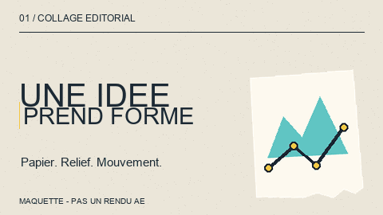
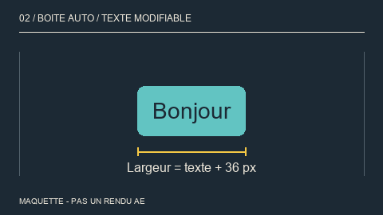
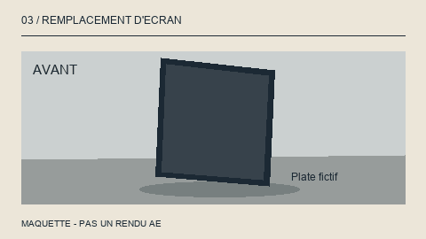
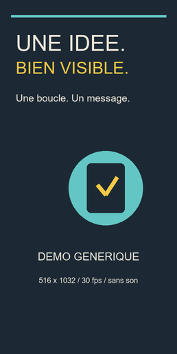
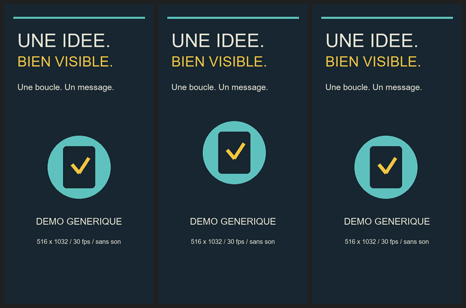
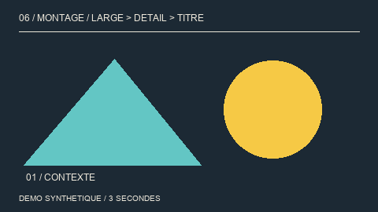
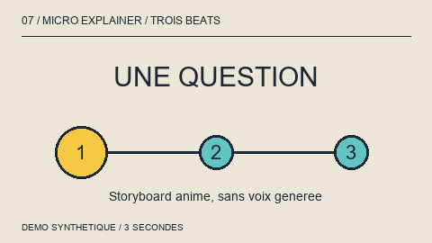

# Gallery — very short examples

**See what each skill can produce**, without opening a client project.
Animations last **3 seconds**. Everything was created for this gallery:
shapes, fictional copy, procedural textures and synthetic sounds.

- **Actual output**: a file genuinely produced by the named helper.
- **Mockup**: a preview of the intended result, not an AE, Premiere,
  Remotion, REA or paid-service execution. No native AEP is included here.
- **Fictitious example**: a sample reporting format, not a verified observation.

GIFs are deliberately small and run at 10 fps for GitHub; they are not delivery
masters. Click MP4/WAV links to play or download the files if GitHub does not
show a player. Three seconds demonstrate a technique, not a recommended length
for an actual advertisement. Existing demo artwork retains its original copy;
French subtitle fixtures intentionally exercise French typography.

## ae-vox-editorial

**Mockup · 3 s** — paper, highlighting, a cutout card and staggered motion.



Short prompt: “Reveal an idea with a highlighter stroke and a paper card.”
[Skill](../skills/after-effects/ae-vox-editorial/SKILL.md)

## ae-expressions-rigs

**Mockup · 3 s** — the text box resizes when the title becomes longer.



Snippet for **Rectangle Path › Size** in AE, to validate in the target project
with a text layer named `TITLE`:

```js
var b = thisComp.layer("TITLE").sourceRectAtTime(time, false);
[b.width + 36, b.height + 24];
```

The GIF is drawn with Pillow: its text metrics are not AE's metrics.
For rectangle positioning and parenting, follow the
[layout library](../skills/after-effects/ae-expressions-rigs/references/layout-text-led.md).

## ae-vfx-compositing

**Mockup · 3 s** — before/after screen replacement on a fictitious set.



This shows the principle of a perspective composite, not an executed tracking
solve or a Keylight/Roto Brush test.
[Skill](../skills/after-effects/ae-vfx-compositing/SKILL.md)

## ae-production-workflow

**Actual manifest-verifier output**, using a synthetic text file:

```json
{"ok": true, "entriesChecked": 1, "canonicalOk": true, "failures": []}
```

[Report](outputs/delivery-check.json) · [Manifest](outputs/delivery-manifest.json) ·
[Canonical fixture](outputs/canonical.txt).
This demonstrates a size/hash check, **not** AEP validity or native inspection.
Checkpoint/RAM examples: [tools](tools.md#ae-helpers).
[Skill](../skills/after-effects/ae-production-workflow/SKILL.md)

## led-signage-content

**Actual output · 3 s · 516×1032 · 30 fps · silent** — readable copy and an
element moving periodically, exported with `led_tool.py`.



[Play the MP4 loop](media/led-loop.mp4) · [Pixel-exact test card](media/led-testcard.png) ·
[Three-panel guides](media/led-guides.png) · [Profile check](outputs/led-check.json).
The thumbnail is reduced; delivery files retain their exact dimensions.
Hardware, brightness and physical synchronization have not been tested.
[Skill](../skills/montage/led-signage-content/SKILL.md)

## video-delivery-qc

**Actual output** — all 90 frames of the loop above were decoded;
the loop seam and absence of audio were checked automatically.



[Full JSON report](outputs/media-qc.json), including the MP4 hash, seam SSIM,
checks, warnings and limitations. `ok` does not certify a physical display.
[Skill](../skills/montage/video-delivery-qc/SKILL.md)

## sound-design-sfx

**Actual output · 3 s** — short sweep → impact → chime, placed by
`sfx_place.py` at frames **9, 30 and 60** on a 30 fps timeline.

[Listen to the 48 kHz / 24-bit stereo WAV](media/sfx.wav) ·
[Play the MP4 with sound](media/sfx-preview.mp4) ·
[Cue placement](outputs/sfx-cues.json) · [Audio measurements](outputs/sfx-qc.json).

Original sounds synthesized locally, with no library samples.
The MP4 adds the stem to the editing mockup: impact on the cut at 1 s,
chime on the title's arrival at 2 s.
Measurements and decoding do not replace human listening.
[Skill](../skills/montage/sound-design-sfx/SKILL.md)

## montage-editing-craft

**Mockup · 3 s** — wide shot, detail, title: three images, one progression.



**Actual `srt_check.py` output** for a French subtitle:
`Bonjour : une idée !` → nonbreaking spaces before `:` and `!`, in a new copy.
[Before](fixtures/captions.srt) · [After](outputs/captions-fixed.srt) ·
[Before report](outputs/captions-before.json) · [After report](outputs/captions-after.json).
The original is unchanged. This is not a Premiere export.
[Skill](../skills/montage/montage-editing-craft/SKILL.md)

## vox-explainer-pipelines

**Structure mockup · 3 s** — question → clue → answer.



This original preview illustrates a beat sheet; it **was not rendered using
the upstream pipelines**. For their own demonstrations, see the
[pinned upstream README](https://github.com/jaredcassoutt/vox-editorial/tree/f394e925f7ccbd6df3e6b3403fcb260194bbece3).
No external clips were copied and no voice was generated.
[Skill](../skills/montage/vox-explainer-pipelines/SKILL.md)

## market-research

**Fictitious example**: “100 venues × 2 purchases/year × €300 = €60,000/year
in modeled potential; three assumptions to verify.”
[Mini-study](reports.md#market-research) · [Skill](../skills/market-research/SKILL.md).

## research-reporting

**Fictitious example**: “Unverified data; validate demand before setting
the price.” [Decision brief](reports.md#research-reporting) ·
[Skill](../skills/research-reporting/SKILL.md).

## backlog-execution

**Fictitious example**: “Brief ready; animation blocked by final copy;
1 of 2 tasks complete.” [Mini-status report](reports.md#backlog-execution) ·
[Skill](../skills/backlog-execution/SKILL.md).

## rea-investigation

**Fictitious example, engine not executed**:
`open file → importDocument() → parseDocument() → preview`.
[Mini-report and limitations](reports.md#rea-investigation) ·
[Skill](../skills/rea-investigation/SKILL.md).

## reverse-api-investigation

**Actual helper output** from two fabricated events: one opaque host,
one endpoint, two 200 responses, no raw URL published in the summary.
[JSON summary](outputs/api-summary.json) · [Fictitious contract](reports.md#reverse-api-investigation) ·
[Skill](../skills/reverse-api-investigation/SKILL.md).

## Tools, provenance and reproduction

- [One micro-example per included tool/helper](tools.md).
- [Micro-examples for catalog-only tools](../docs/montage-catalog.md#micro-examples-for-catalog-only-tools)
  — illustrative output briefs, not installed or executed engines.
- [Example manifest](manifest.json): coverage, provenance, sizes and SHA-256.
- [Generation environment](outputs/build-info.json): no cloud calls,
  client media or native AE rendering. System fonts were used for rendering;
  font files are not redistributed.
- Original examples follow [RIGHTS.md](../RIGHTS.md) (`UNLICENSED`).
  No third-party media is redistributed; MIT snapshots remain unchanged.

To recreate media and helper outputs in a **new** directory:

```sh
# Python + Pillow >= 9.2 + FFmpeg/libx264 + Node must be available separately.
python examples/build.py --out .local/examples-preview
# If needed, add --font /path/to/a-licensed-font.ttf
npm test
```

The generator installs and deletes nothing, and refuses an existing directory.
It never writes directly into the published gallery. Image and encoded-file
bytes may vary with engine and font versions; review outputs before updating
hashes. No QC threshold is changed to make a new generation pass.
